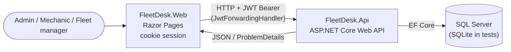

# FleetDesk

> Fleet maintenance platform built with ASP.NET Core 8: overdue-service tracking, a work-order state machine, and spare-parts inventory protected by optimistic concurrency.

[](https://github.com/edu-tech220/fleetdesk/actions/workflows/ci.yml)


---

## 📌 Overview

FleetDesk manages preventive and corrective maintenance for vehicle fleets (pickups, vans,
delivery units). It tackles a real problem for any company that runs its own vehicles:
knowing **which units are overdue for service**, **controlling the workshop's work orders**, and
**not running out of spare parts halfway through a repair** when several mechanics work at the same time.

## ✨ Key features and business rules

- **Maintenance plans**: each vehicle is serviced every *N* kilometers or *M* months. A vehicle is
  **overdue** when either rule is met (or when it has no service history); an overdue report is exposed by the API.
- **One open work order per vehicle**: a new order can only be opened for an `Active` vehicle, which
  then switches to `InShop` until the order is completed or cancelled.
- **Per-mechanic capacity**: a mechanic can have at most **3 open work orders** (`Pending`,
  `InProgress` or `WaitingParts`) at the same time.
- **Parts consumption with optimistic concurrency**: adding a part to an order deducts stock; if two
  mechanics try to take the last unit at almost the same time, the second one gets a clear
  `409 Conflict` instead of driving stock negative.
- **Automatic "waiting for parts"**: if there is not enough stock, the order moves to `WaitingParts`;
  it returns to `InProgress` once a part is successfully added.
- **Closing an order** validates the closing odometer (cannot be lower than at opening), updates the
  vehicle's odometer and last-service data — which recalculates its next maintenance — and sets it back to `Active`.
- **Unique constraints** on vehicle plate numbers and part SKUs.

## 🏗️ Architecture

Two independent ASP.NET Core applications that **share no assemblies** (each defines its own DTOs;
only the test project references the backend, to use `WebApplicationFactory`).



- **FleetDesk.Api** – backend service with all the business logic (vehicles, parts, work orders,
  reports), exposing a REST API documented with Swagger.
- **FleetDesk.Web** – Razor Pages frontend (HTML + CSS, no JavaScript framework) that calls the backend
  through `IHttpClientFactory`. Users log in against the backend and the returned JWT is stored as a
  claim inside the site's authentication cookie; a `DelegatingHandler` (`JwtForwardingHandler`) reads it
  on every request and forwards it as `Authorization: Bearer` to the API.
- **FleetDesk.Api.Tests** – end-to-end xUnit tests with `WebApplicationFactory`, replacing SQL Server
  with in-memory SQLite. No Docker or external services required.

## 🧠 Technical decisions

- **Optimistic concurrency without native `rowversion`** – instead of relying on SQL Server's
  `rowversion`/`timestamp` (which SQLite does not support the same way), `Part` carries a `Guid RowVersion`
  that the application renews on every stock change. Clients send back the value they read; the backend
  sets it as the `OriginalValue` of the EF Core concurrency token before saving, so a concurrent change
  raises a real `DbUpdateConcurrencyException`, translated to `409 Conflict`. This behaves identically
  on SQL Server and SQLite, so it can be covered by automated tests without a SQL Server instance.
- **Explicit work-order state machine** –
  `Pending → InProgress ⇄ WaitingParts → Completed`, with `Cancelled` from any non-final state.
  Invalid transitions return `409 Conflict` with a clear message instead of failing silently.
- **Migrations vs. `EnsureCreated`** – the API applies real EF Core migrations against SQL Server on
  startup. Tests use `EnsureCreated()` on SQLite instead, because some SQL Server column types generated
  by the migrations (`nvarchar(max)`) are not valid in SQLite; `EnsureCreated` builds the schema from
  the model using the active provider.
- **Role-based + resource-ownership authorization** – `Admin`, `Mechanic` and `FleetManager` have
  different permissions via `[Authorize(Roles = ...)]`, and a mechanic can only modify their own work
  orders (an admin can modify any).
- **PBKDF2 password hashing** – `Rfc2898DeriveBytes` with SHA-256, 100,000 iterations and a random
  per-user salt.
- **Rate limiting** – ASP.NET Core's built-in limiter, global fixed window of 100 requests/minute per IP.
- **Consistent ProblemDetails** – a central middleware maps domain exceptions (`NotFoundException`,
  `BusinessRuleException`, `ConcurrencyConflictException`, `ForbiddenException`) to
  `application/problem+json` responses with the right HTTP status (404 / 409 / 409 / 403).

## 🧰 Tech stack

| Layer | Technology |
|---|---|
| Language / runtime | C# / .NET 8 |
| Backend | ASP.NET Core Web API (controllers), Swagger (Swashbuckle) |
| Frontend | ASP.NET Core Razor Pages, cookie authentication |
| Data access | Entity Framework Core 8 (migrations) |
| Database | SQL Server 2022 (SQLite in-memory for tests) |
| Auth | JWT Bearer, PBKDF2 password hashing |
| Resilience | ASP.NET Core rate limiting, optimistic concurrency |
| Testing | xUnit, `WebApplicationFactory` |
| DevOps | Docker, Docker Compose, GitHub Actions (build, test, Docker image build) |

## 🚀 Getting started

### Option 1: Docker Compose (API + Web + SQL Server)

```bash
docker compose up --build
```

| Service | URL |
|---|---|
| Web (Razor Pages) | http://localhost:8081 |
| API | http://localhost:8080 |
| SQL Server | `localhost:1433` |

The API applies migrations and seeds sample data (vehicles, parts and users) on startup. The containers
run with `ASPNETCORE_ENVIRONMENT=Production`, so Swagger UI is only available when running the API locally
in Development (option 2). Credentials in `docker-compose.yml` and `appsettings.json` are for local
development only.

Seeded users:

| Username | Password | Role |
|---|---|---|
| `admin` | `Admin123!` | Admin |
| `mecanico1` | `Mecanico123!` | Mechanic |
| `mecanico2` | `Mecanico123!` | Mechanic |
| `gerente` | `Gerente123!` | FleetManager |

### Option 2: locally with the .NET SDK

Requires the .NET 8 SDK and a reachable SQL Server (e.g. `docker compose up sqlserver`).

```bash
# Backend -> http://localhost:5181  (Swagger UI at /swagger)
dotnet run --project src/FleetDesk.Api

# Frontend -> http://localhost:5217  (in another terminal; it already points at the local API)
dotnet run --project src/FleetDesk.Web
```

The connection string lives in `ConnectionStrings:DefaultConnection` (`src/FleetDesk.Api/appsettings.json`)
and the frontend's API address in `Api:BaseUrl` (`src/FleetDesk.Web/appsettings.json`); adjust them if you
use other hosts or ports.

## 🧪 Running tests

```bash
dotnet test
```

**23 tests** running against in-memory SQLite through `WebApplicationFactory` — no Docker or SQL Server needed. They cover:

- JWT authentication (valid/invalid login, access without a token);
- vehicle rules (duplicate plate numbers, overdue calculation by kilometers and by date);
- optimistic concurrency when restocking/consuming parts (stale `RowVersion` → 409);
- the work-order state machine (invalid transitions, per-mechanic open-order limit, automatic switch to
  `WaitingParts`, closing an order updates the odometer);
- role-based and ownership authorization (a mechanic cannot modify another mechanic's order).

CI (`.github/workflows/ci.yml`) restores, builds and tests the solution, then builds both Docker images.

## 🔌 API endpoints

All endpoints except login require a JWT.

| Method | Route | Roles | Description |
|---|---|---|---|
| `POST` | `/api/auth/login` | Anonymous | Log in, returns a JWT |
| `GET` | `/api/vehicles?page=&pageSize=&overdueOnly=` | Any authenticated | List vehicles (paginated) |
| `GET` | `/api/vehicles/{id}` | Any authenticated | Vehicle details |
| `POST` | `/api/vehicles` | Admin | Register a vehicle with its maintenance plan |
| `GET` | `/api/parts?page=&pageSize=` | Any authenticated | List parts (paginated) |
| `GET` | `/api/parts/{id}` | Any authenticated | Part details (includes `RowVersion`) |
| `POST` | `/api/parts` | Admin | Create a part |
| `POST` | `/api/parts/{id}/restock` | Admin | Restock a part (optimistic concurrency) |
| `GET` | `/api/workorders?page=&pageSize=&status=` | Any authenticated | List work orders (paginated, filter by status) |
| `GET` | `/api/workorders/{id}` | Any authenticated | Work order details |
| `POST` | `/api/workorders` | Admin, Mechanic | Open a work order for a vehicle |
| `POST` | `/api/workorders/{id}/start` | Admin, Mechanic (owner) | `Pending → InProgress` |
| `POST` | `/api/workorders/{id}/parts` | Admin, Mechanic (owner) | Consume a part (stock deduction, may move to `WaitingParts`) |
| `POST` | `/api/workorders/{id}/complete` | Admin, Mechanic (owner) | Close the order and update the vehicle's odometer |
| `POST` | `/api/workorders/{id}/cancel` | Admin, Mechanic (owner) | Cancel an open order |
| `GET` | `/api/reports/overdue-vehicles` | Any authenticated | Vehicles overdue for maintenance (paginated) |

Sample requests are available in `src/FleetDesk.Api/FleetDesk.Api.http`.

## 📁 Project structure

```
FleetDesk.sln
├── src/
│   ├── FleetDesk.Api/            # Backend Web API + EF Core
│   │   ├── Auth/                 # JWT token service, PBKDF2 hasher
│   │   ├── Controllers/          # Auth, Vehicles, Parts, WorkOrders, Reports
│   │   ├── Services/             # Business logic
│   │   ├── Domain/               # Entities, roles, domain exceptions
│   │   ├── Data/                 # DbContext, migrations, seeder
│   │   ├── Dtos/                 # Request/response contracts
│   │   ├── Middleware/           # Exception -> ProblemDetails
│   │   └── Dockerfile
│   └── FleetDesk.Web/            # Razor Pages frontend
│       ├── Pages/                # Vehicles, WorkOrders, Parts, Reports, Login
│       ├── Services/             # Typed API client, JwtForwardingHandler
│       └── Dockerfile
├── tests/
│   └── FleetDesk.Api.Tests/      # xUnit tests (in-memory SQLite)
├── docker-compose.yml            # API + Web + SQL Server
└── .github/workflows/ci.yml      # Build, test, Docker images
```
